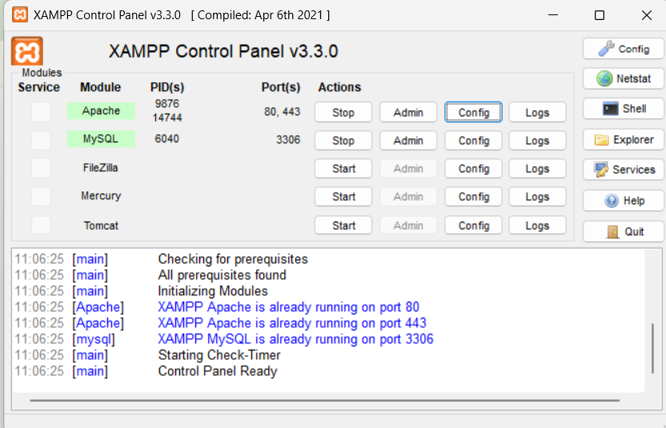
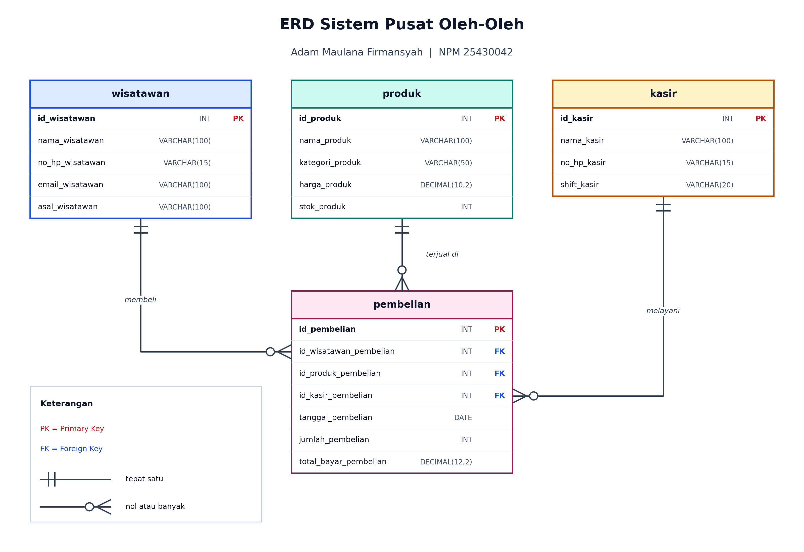
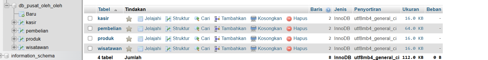
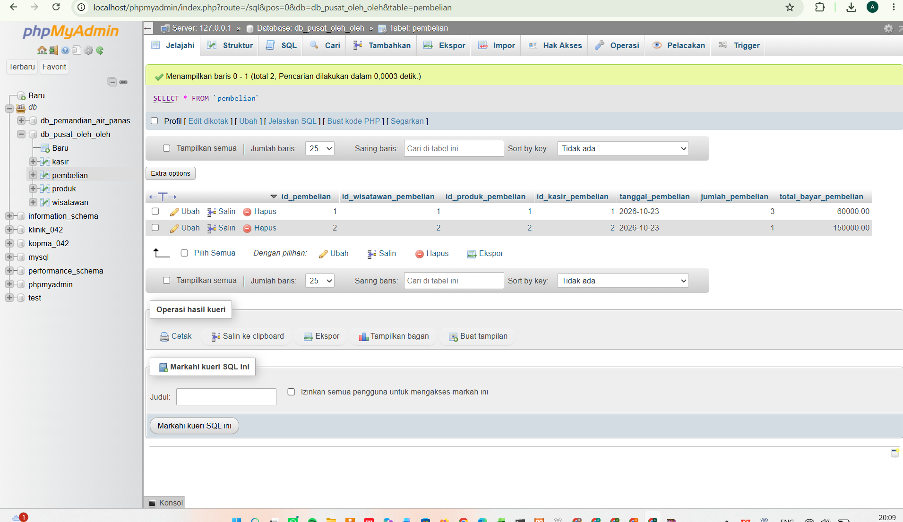
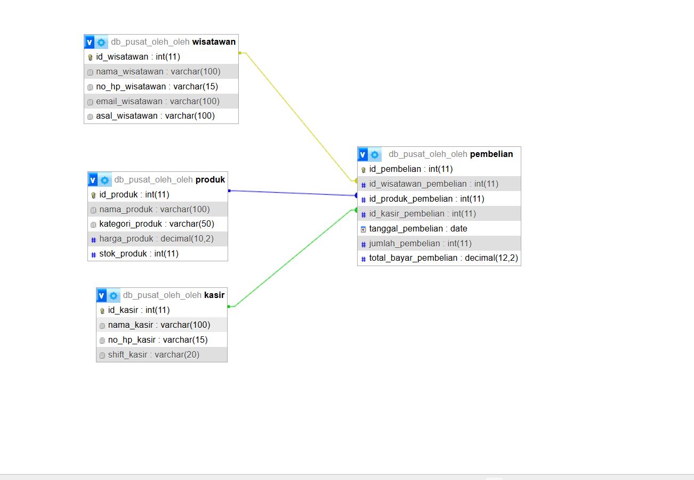
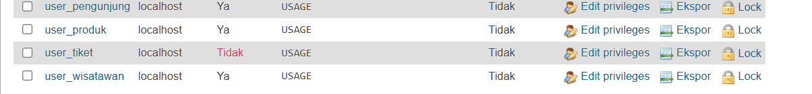
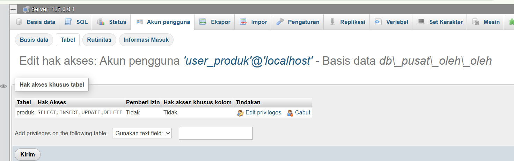
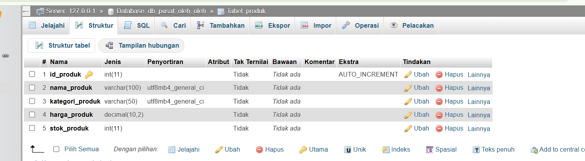
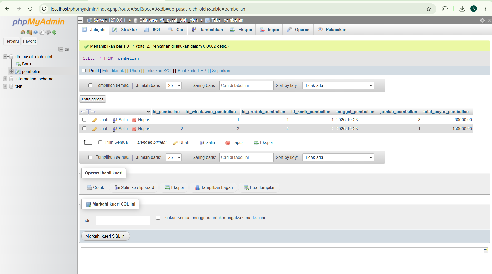

# Laporan Tugas ERD - Sistem Pusat Oleh-Oleh

- **Nama:** ADAM MAULANA FIRMANSYAH
- **NIM:** 25430042
- **Kelas:** B
- **Tanggal:** 23 Oktober 2026
- **Asisten/Dosen:** Dedi Irawan, S.Kom., M.T.I.

## 1. Tujuan Praktikum

Saya dapat memodelkan sistem informasi skala kecil ke dalam bentuk ERD dengan notasi Crow's Foot, yang terdiri dari empat entitas: master subjek, master objek, master aktor, dan transaksi. Saya dapat menentukan atribut, tipe data, primary key (PK), dan foreign key (FK) pada setiap entitas dengan aturan penamaan `namafield_namatabel`, serta menentukan kardinalitas relasi antar entitas. Saya dapat menerjemahkan ERD tersebut menjadi basis data dan tabel di phpMyAdmin, lalu membuat akun pengguna yang hak aksesnya dibatasi pada satu tabel saja.

## 2. Ringkasan Dasar Teori

Entity Relationship Diagram (ERD) adalah diagram untuk menggambarkan data yang disimpan oleh suatu sistem. ERD terdiri dari entitas (objek yang datanya disimpan), atribut (keterangan dari entitas), dan relasi (hubungan antar entitas). Pada notasi Crow's Foot, entitas digambar sebagai tabel, sedangkan kardinalitas ditunjukkan oleh ujung garis relasi: garis tegak berarti satu, dan kaki gagak berarti banyak.

Primary key (PK) adalah atribut yang nilainya unik dan mengidentifikasi satu baris pada tabel. Foreign key (FK) adalah atribut pada suatu tabel yang merujuk ke PK tabel lain, sehingga data dua tabel dapat dihubungkan dan konsistensinya terjaga.

Pada pola empat entitas, tabel transaksi menghubungkan tiga tabel master. Relasi dari tiap tabel master ke tabel transaksi bersifat One-to-Many, karena satu data master dapat muncul pada banyak transaksi, sedangkan satu transaksi hanya merujuk ke satu data pada masing-masing tabel master.

Pada MariaDB, hak akses diberikan kepada akun dalam bentuk `nama_user@host`. Hak akses dapat diatur pada tingkat server, basis data, atau tabel. Pada tugas ini digunakan prinsip least privilege, yaitu setiap akun hanya diberi hak pada tabel yang dibutuhkannya.

## 3. Hasil Langkah Percobaan

### 3.1 Menyiapkan XAMPP dan phpMyAdmin

Saya menjalankan layanan **Apache** dan **MySQL** (MariaDB) melalui XAMPP Control Panel sampai keduanya berstatus berjalan, lalu membuka phpMyAdmin melalui `localhost/phpmyadmin`.



### 3.2 Merancang ERD

Tema sistem yang saya kerjakan adalah **Pusat Oleh-Oleh** dengan pembagian entitas sebagai berikut.

| Peran | Entitas |
|---|---|
| Tabel 1 (Master Subjek) | `wisatawan` |
| Tabel 2 (Master Objek) | `produk` |
| Tabel 3 (Master Aktor) | `kasir` |
| Tabel 4 (Transaksi) | `pembelian` |

Atribut, tipe data, dan kunci pada tiap tabel:

| Tabel | Atribut | Tipe data | Kunci |
|---|---|---|---|
| `wisatawan` | id_wisatawan | INT | PK |
| | nama_wisatawan | VARCHAR(100) | |
| | no_hp_wisatawan | VARCHAR(15) | |
| | email_wisatawan | VARCHAR(100) | |
| | asal_wisatawan | VARCHAR(100) | |
| `produk` | id_produk | INT | PK |
| | nama_produk | VARCHAR(100) | |
| | kategori_produk | VARCHAR(50) | |
| | harga_produk | DECIMAL(10,2) | |
| | stok_produk | INT | |
| `kasir` | id_kasir | INT | PK |
| | nama_kasir | VARCHAR(100) | |
| | no_hp_kasir | VARCHAR(15) | |
| | shift_kasir | VARCHAR(20) | |
| `pembelian` | id_pembelian | INT | PK |
| | id_wisatawan_pembelian | INT | FK ke wisatawan |
| | id_produk_pembelian | INT | FK ke produk |
| | id_kasir_pembelian | INT | FK ke kasir |
| | tanggal_pembelian | DATE | |
| | jumlah_pembelian | INT | |
| | total_bayar_pembelian | DECIMAL(12,2) | |

Seluruh atribut memakai format penamaan `namafield_namatabel`, misalnya `no_hp_wisatawan`, bukan sekadar `hp`.



### 3.3 Menentukan Kardinalitas

Relasi yang saya gunakan:

- `wisatawan` ke `pembelian`: One-to-Many. Satu wisatawan dapat melakukan banyak pembelian, tetapi setiap pembelian hanya dilakukan satu wisatawan.
- `produk` ke `pembelian`: One-to-Many. Satu produk dapat muncul pada banyak pembelian, tetapi setiap pembelian mencatat satu produk.
- `kasir` ke `pembelian`: One-to-Many. Satu kasir dapat melayani banyak pembelian, tetapi setiap pembelian dilayani satu kasir.

### 3.4 Membuat Basis Data dan Tabel

Rancangan ERD saya terjemahkan menjadi skrip `db_pusat_oleh_oleh.sql`. Skrip membuat basis data `db_pusat_oleh_oleh` dengan character set `utf8mb4`, lalu membuat tabel dengan urutan: tiga tabel master terlebih dahulu (`wisatawan`, `produk`, `kasir`), baru tabel transaksi `pembelian`. Urutan ini penting karena FK pada `pembelian` hanya dapat dibuat jika tabel yang dirujuk sudah ada.

Skrip diimpor melalui tab **Import** di phpMyAdmin. Setelah impor berhasil, basis data dan empat tabel muncul di panel kiri.



### 3.5 Memeriksa Struktur Tabel dan Relasi

Saya membuka tab **Structure** pada setiap tabel untuk memeriksa nama atribut, tipe data, dan kunci. Pada tabel `pembelian`, kolom `id_pembelian` bertanda PK, dan tiga kolom FK terdaftar pada **Relation view**.



Selanjutnya saya membuka tab **Designer** untuk melihat diagram relasi antar tabel. Garis relasi dari `wisatawan`, `produk`, dan `kasir` menuju `pembelian` sesuai dengan ERD yang saya rancang.



### 3.6 Membuat Akun Pengguna

Saya membuat empat akun, masing-masing untuk satu tabel. Nama akun `user_kasir_oleh` sengaja dibedakan dari `user_kasir` milik tugas sebelumnya agar tidak bentrok di server yang sama.

| Akun | Tabel yang boleh diakses | Password |
|---|---|---|
| `user_wisatawan@localhost` | `wisatawan` | Ada |
| `user_produk@localhost` | `produk` | Ada |
| `user_kasir_oleh@localhost` | `kasir` | Ada |
| `user_pembelian@localhost` | `pembelian` | Tanpa password |

Perintah dijalankan melalui tab **SQL** setelah basis data `db_pusat_oleh_oleh` dipilih di panel kiri (password sebenarnya tidak dituliskan di laporan):

```sql
CREATE USER 'user_produk'@'localhost' IDENTIFIED BY '********';
CREATE USER 'user_pembelian'@'localhost' IDENTIFIED BY '';
```

### 3.7 Memberikan Hak Akses per Tabel

Setiap akun diberi hak `SELECT, INSERT, UPDATE, DELETE` hanya pada tabel miliknya:

```sql
GRANT SELECT, INSERT, UPDATE, DELETE ON db_pusat_oleh_oleh.produk TO 'user_produk'@'localhost';
GRANT SELECT, INSERT, UPDATE, DELETE ON db_pusat_oleh_oleh.pembelian TO 'user_pembelian'@'localhost';
FLUSH PRIVILEGES;
```

Perintah yang sama diterapkan untuk `wisatawan` dan `kasir` pada akunnya masing-masing. Seluruh perintah tersimpan pada skrip `akun_pusat_oleh_oleh.sql`.

### 3.8 Memeriksa Akun dan Hak Akses

Pada halaman **User accounts**, keempat akun muncul. Kolom password `user_pembelian` bertuliskan **Tidak**, sedangkan tiga akun lainnya **Ya**. Kolom hak akses global menampilkan `USAGE`, yang berarti tidak ada hak di tingkat server.



Pada **Edit privileges** akun `user_produk`, tab **Database** menampilkan `db_pusat_oleh_oleh` dengan keterangan *Hak akses khusus tabel: Ya*. Pada bagian hak akses tabel, hanya tabel `produk` yang tercatat dengan hak `SELECT, INSERT, UPDATE, DELETE`.



### 3.9 Menguji Login Akun

Saya menguji login dengan `user_produk` menggunakan passwordnya. Akun ini dapat membuka basis data `db_pusat_oleh_oleh` dan hanya bekerja pada tabel `produk`.



Untuk `user_pembelian` yang tanpa password, login dilakukan dengan mengosongkan kolom password. phpMyAdmin hanya mengizinkannya karena `AllowNoPassword` pada `config.inc.php` sudah saya ubah menjadi `true`. Akun ini hanya dapat bekerja pada tabel `pembelian`.



## 4. Jawaban Titik Analisis

### Titik Analisis 1

Tabel `pembelian` memuat tiga FK karena fungsinya mencatat satu kejadian pembelian yang melibatkan tiga pihak: siapa yang membeli (`id_wisatawan_pembelian`), produk apa yang dibeli (`id_produk_pembelian`), dan siapa yang melayani (`id_kasir_pembelian`). Data wisatawan, produk, dan kasir dipisah ke tabel master agar tidak ditulis berulang di setiap transaksi. Jika harga dan nama produk ditulis langsung di tabel `pembelian`, data yang sama harus disimpan berkali-kali dan lebih mudah menjadi tidak konsisten.

### Titik Analisis 2

Tabel `pembelian` saya beri `id_pembelian` sebagai PK. Tiga FK saja tidak cukup untuk membedakan setiap transaksi, karena wisatawan yang sama dapat membeli produk yang sama, pada kasir yang sama, di hari yang sama. Tanpa PK sendiri, dua pembelian seperti itu tampak identik. Dengan `id_pembelian`, setiap pembelian punya identitas unik.

### Titik Analisis 3

FK dibuat dengan `ON UPDATE CASCADE ON DELETE RESTRICT`. Dengan `ON DELETE RESTRICT`, data master seperti `produk` yang masih tercatat pada suatu pembelian tidak dapat dihapus, sehingga riwayat transaksi tidak kehilangan rujukannya. Dengan `ON UPDATE CASCADE`, perubahan nilai PK pada tabel master ikut diperbarui pada tabel `pembelian`.

### Titik Analisis 4

Karena hak akses diberikan per tabel, akun `user_produk` dapat bekerja pada tabel `produk` tetapi ditolak pada tabel lain. Jika `user_produk` menjalankan `SELECT` pada tabel `wisatawan`, MariaDB menolak dengan `ERROR 1142` karena akun tersebut tidak punya izin pada tabel itu. Artinya akun dikenali dan sudah berhasil login, tetapi tidak berhak menjalankan perintah pada objek tertentu. Hal ini berbeda dengan `ERROR 1045` yang berarti login gagal. Akun `user_pembelian` tanpa password kurang aman, sehingga hanya layak dipakai di komputer sendiri untuk latihan.

## 5. Hasil Latihan dan Modifikasi

Selain atribut minimal, saya menambahkan atribut berikut agar rancangan lebih sesuai dengan kebutuhan sistem:

- `email_wisatawan` dan `asal_wisatawan` pada tabel `wisatawan`, untuk menyimpan kontak dan daerah asal wisatawan.
- `kategori_produk` dan `stok_produk` pada tabel `produk`, untuk mengelompokkan oleh-oleh dan mencatat persediaan.
- `total_bayar_pembelian` pada tabel `pembelian`, untuk menyimpan nilai transaksi.

Semua atribut mengikuti format `namafield_namatabel`.

Saya juga membuat akun `user_pembelian` tanpa password sebagai pembanding terhadap tiga akun yang memakai password.

## 6. Tugas Mandiri: Rancangan ERD

Identitas rancangan:

- Tema: Pusat Oleh-Oleh
- Entitas: `wisatawan`, `produk`, `kasir`, `pembelian`
- Basis data: `db_pusat_oleh_oleh`
- Akun: `user_wisatawan`, `user_produk`, `user_kasir_oleh`, `user_pembelian`
- Notasi: Crow's Foot

Keputusan desain: tabel transaksi diberi PK sendiri (`id_pembelian`) agar setiap pembelian dapat dibedakan. Tiga tabel master dipisah agar data tidak berulang, dan semua relasi dibuat One-to-Many menuju `pembelian`. Setiap akun dibatasi pada satu tabel agar kesalahan atau penyalahgunaan satu akun tidak memengaruhi tabel lain (prinsip least privilege).

## 7. Pembahasan dan Kendala

**Kendala 1: `ERROR 1072 Key column doesn't exist in table`.** Saat mengimpor skrip tabel, phpMyAdmin menolak pembuatan tabel `wisatawan` dengan pesan `#1072 - Key column 'Maulana' doesn't exist in table`. Penyebabnya, berkas `.sql` yang saya edit berisi `PRIMARY KEY (Maulana)`, padahal kunci utama harus menunjuk ke nama kolom yang ada. Saya memperbaikinya dengan memakai berkas yang bersih, sehingga barisnya menjadi `PRIMARY KEY (id_wisatawan)`, dan memeriksa keempat baris `PRIMARY KEY` pada skrip.

**Kendala 2: `ERROR 1050 Table already exists`.** Setelah impor yang gagal, tabel `wisatawan` sempat terbentuk setengah jadi sehingga impor berikutnya menabraknya. Saya menghapus basis data yang setengah jadi dengan perintah berikut, lalu mengimpor ulang:

```sql
DROP DATABASE IF EXISTS db_pusat_oleh_oleh;
```

Setelah impor ulang, phpMyAdmin menampilkan pesan bahwa 10 kueri berhasil dilakukan.

**Kendala 3: pesan `ERROR 1046 No database selected`.** Pesan ini muncul pada perintah `CREATE DATABASE` dan `USE` di awal impor, serta setelah `DROP DATABASE`, karena saat itu belum ada basis data yang terpilih. Pesan tersebut tidak menggagalkan proses: keempat tabel dan data contoh tetap berhasil dibuat, sehingga saya menganggapnya sebagai efek samping tampilan.

**Catatan 4: `Note #1974 Can't drop user ... it doesn't exist`.** Pesan ini muncul saat `DROP USER IF EXISTS` dijalankan sebelum membuat akun. Ini hanya catatan bahwa akun yang akan dihapus memang belum ada, bukan galat.

## 8. Kesimpulan

Tugas ini membantu saya memodelkan sistem Pusat Oleh-Oleh ke dalam ERD empat entitas, menentukan PK, FK, tipe data, dan kardinalitas One-to-Many, lalu mewujudkannya sebagai basis data `db_pusat_oleh_oleh` di phpMyAdmin. Saya juga membuat empat akun yang hak aksesnya dibatasi pada satu tabel.

## 9. Pernyataan Penggunaan AI

Saya menggunakan AI sebagai alat bantu untuk memahami pola ERD empat entitas, menyusun atribut dan tipe data, membuat gambar ERD, menyusun skrip SQL, dan merapikan laporan. Perintah dijalankan dan hasil percobaan saya periksa sendiri di komputer saya.

## 10. Bukti Git

- Repositori: `https://github.com/adam25430042/tugas-erd-25430042`
- Commit: `[isi pesan commit]`
- Hash commit: `[isi hash commit]`

Bukti commit dan isi repositori tersimpan di GitHub.


## Checklist

- [x] ERD Crow's Foot (PNG dan PDF)
- [x] Tabel atribut, tipe data, PK, dan FK
- [x] Aturan penamaan `namafield_namatabel`
- [x] Kardinalitas relasi
- [x] db_pusat_oleh_oleh.sql
- [x] Bukti basis data dan empat tabel di phpMyAdmin
- [x] Bukti struktur tabel pembelian
- [x] Bukti Designer / relasi
- [x] Bukti User accounts
- [x] Bukti hak akses per tabel
- [x] Bukti login akun
- [x] akun_pusat_oleh_oleh.sql
- [x] Titik Analisis 1 sampai 4
- [x] Git push dan commit
