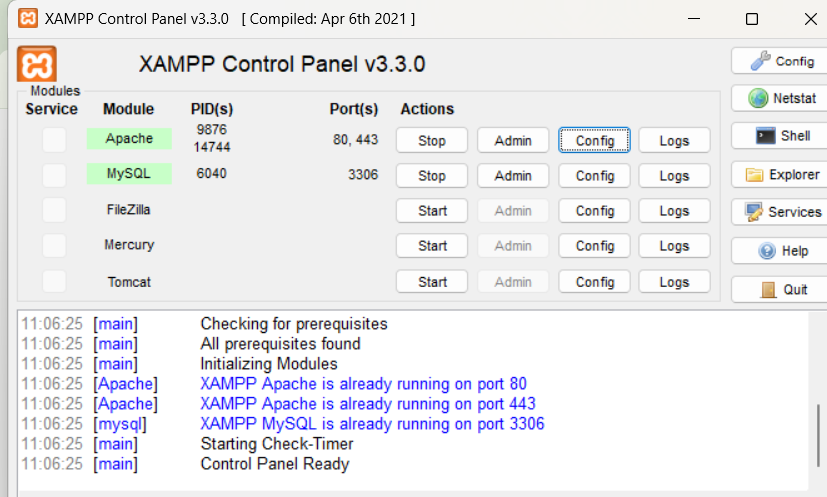
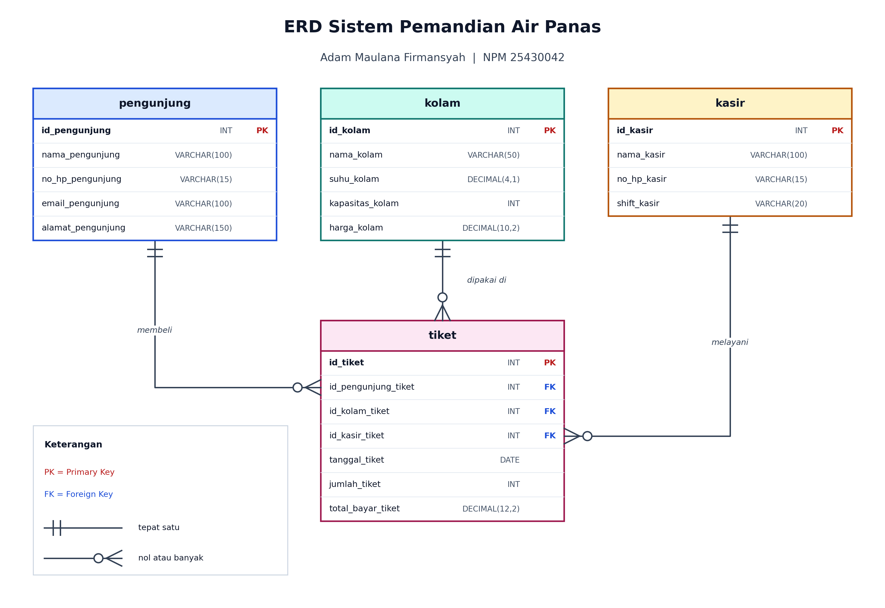
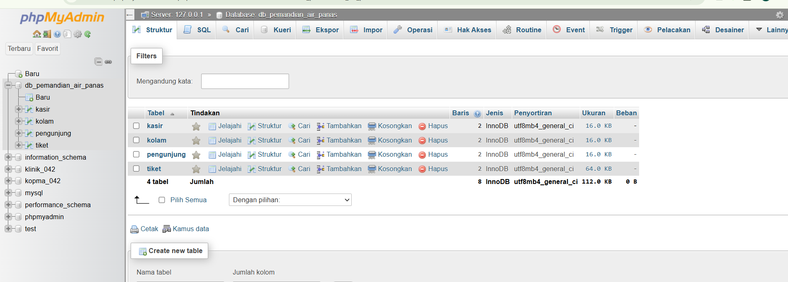
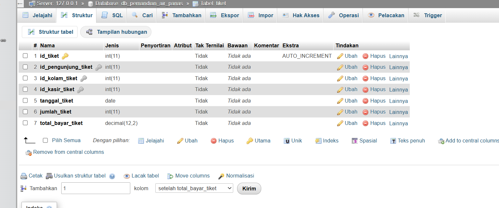
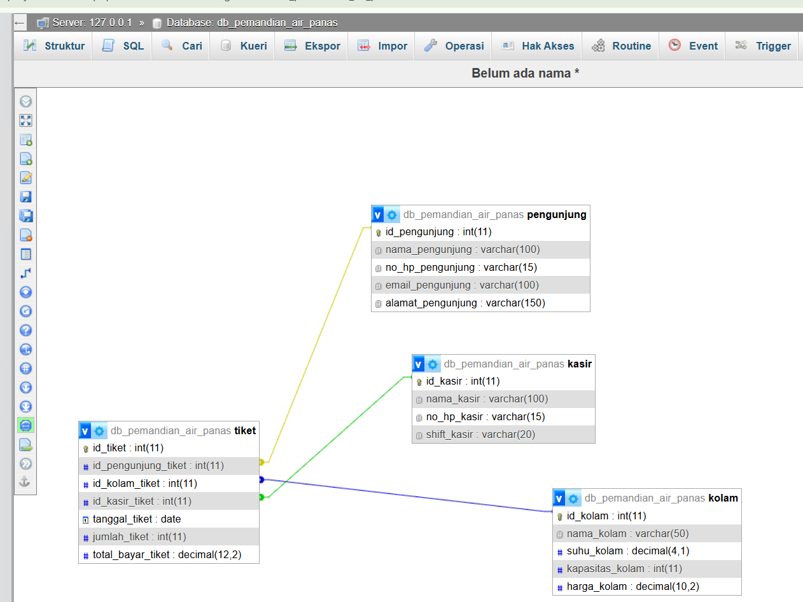
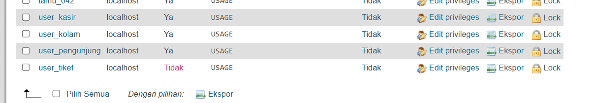
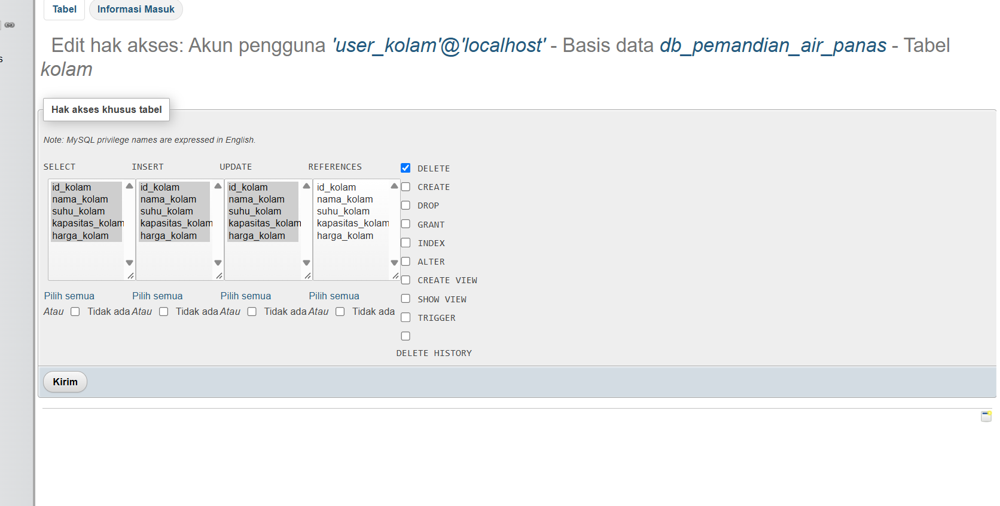
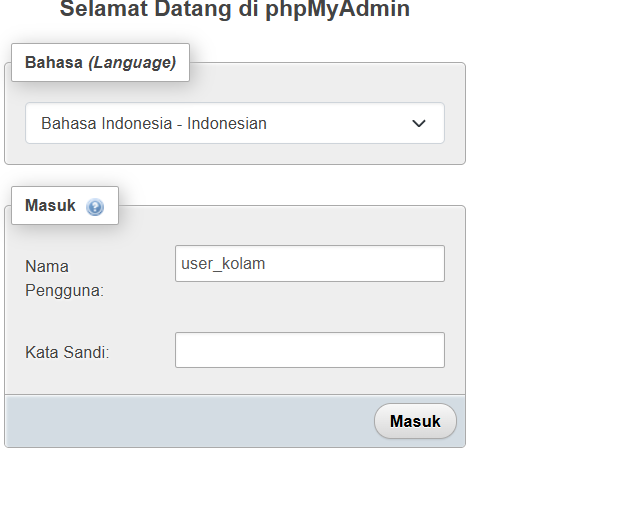
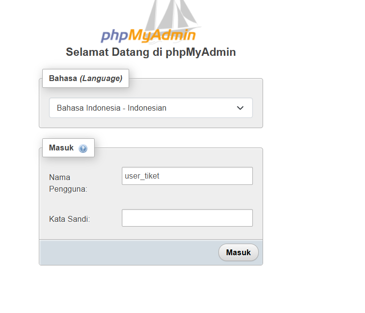
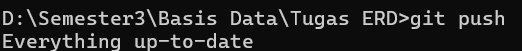

# Laporan Praktikum Basis Data - Pertemuan 02

- **Nama:** ADAM MAULANA FIRMANSYAH
- **NIM:** 25430042
- **Kelas:** B
- **Tanggal:** 23 Oktober 2026
- **Asisten/Dosen:** Dedi Irawan, S.Kom., M.T.I.

## 1. Tujuan Praktikum

Saya dapat memodelkan sistem informasi skala kecil ke dalam bentuk ERD dengan notasi Crow's Foot, yang terdiri dari empat entitas: master subjek, master objek, master aktor, dan transaksi. Saya dapat menentukan atribut, tipe data, primary key (PK), dan foreign key (FK) pada setiap entitas dengan aturan penamaan `namafield_namatabel`, serta menentukan kardinalitas relasi antar entitas. Saya dapat menerjemahkan ERD tersebut menjadi basis data dan tabel di phpMyAdmin, lalu membuat akun pengguna yang hak aksesnya dibatasi pada satu tabel saja.

## 2. Ringkasan Dasar Teori

Entity Relationship Diagram (ERD) adalah diagram untuk menggambarkan data yang disimpan oleh suatu sistem. ERD terdiri dari entitas (objek yang datanya disimpan), atribut (keterangan dari entitas), dan relasi (hubungan antar entitas). Pada notasi Crow's Foot, entitas digambar sebagai tabel, sedangkan kardinalitas ditunjukkan oleh ujung garis relasi: garis tegak berarti satu, dan kaki gagak berarti banyak.

Primary key (PK) adalah atribut yang nilainya unik dan mengidentifikasi satu baris pada tabel. Foreign key (FK) adalah atribut pada suatu tabel yang merujuk ke PK tabel lain, sehingga data dua tabel dapat dihubungkan dan konsistensinya terjaga.

Pada pola empat entitas, tabel transaksi menghubungkan tiga tabel master. Relasi dari tiap tabel master ke tabel transaksi bersifat One-to-Many, karena satu data master dapat muncul pada banyak transaksi, sedangkan satu transaksi hanya merujuk ke satu data pada masing-masing tabel master.

Pada MariaDB, hak akses diberikan kepada akun dalam bentuk `nama_user@host`. Hak akses dapat diatur pada tingkat server, basis data, atau tabel. Pada praktikum ini digunakan prinsip least privilege, yaitu setiap akun hanya diberi hak pada tabel yang dibutuhkannya.

## 3. Hasil Langkah Percobaan

### 3.1 Menyiapkan XAMPP dan phpMyAdmin

Saya menjalankan layanan **Apache** dan **MySQL** (MariaDB) melalui XAMPP Control Panel sampai keduanya berstatus berjalan, lalu membuka phpMyAdmin melalui `localhost/phpmyadmin`.



### 3.2 Merancang ERD

Tema sistem yang saya kerjakan adalah **Pemandian Air Panas** dengan pembagian entitas sebagai berikut.

| Peran | Entitas |
|---|---|
| Tabel 1 (Master Subjek) | `pengunjung` |
| Tabel 2 (Master Objek) | `kolam` |
| Tabel 3 (Master Aktor) | `kasir` |
| Tabel 4 (Transaksi) | `tiket` |

Atribut, tipe data, dan kunci pada tiap tabel:

| Tabel | Atribut | Tipe data | Kunci |
|---|---|---|---|
| `pengunjung` | id_pengunjung | INT | PK |
| | nama_pengunjung | VARCHAR(100) | |
| | no_hp_pengunjung | VARCHAR(15) | |
| | email_pengunjung | VARCHAR(100) | |
| | alamat_pengunjung | VARCHAR(150) | |
| `kolam` | id_kolam | INT | PK |
| | nama_kolam | VARCHAR(50) | |
| | suhu_kolam | DECIMAL(4,1) | |
| | kapasitas_kolam | INT | |
| | harga_kolam | DECIMAL(10,2) | |
| `kasir` | id_kasir | INT | PK |
| | nama_kasir | VARCHAR(100) | |
| | no_hp_kasir | VARCHAR(15) | |
| | shift_kasir | VARCHAR(20) | |
| `tiket` | id_tiket | INT | PK |
| | id_pengunjung_tiket | INT | FK ke pengunjung |
| | id_kolam_tiket | INT | FK ke kolam |
| | id_kasir_tiket | INT | FK ke kasir |
| | tanggal_tiket | DATE | |
| | jumlah_tiket | INT | |
| | total_bayar_tiket | DECIMAL(12,2) | |

Seluruh atribut memakai format penamaan `namafield_namatabel`, misalnya `no_hp_pengunjung`, bukan sekadar `hp`.



### 3.3 Menentukan Kardinalitas

Relasi yang saya gunakan:

- `pengunjung` ke `tiket`: One-to-Many. Satu pengunjung dapat membeli banyak tiket, tetapi setiap tiket hanya dimiliki satu pengunjung.
- `kolam` ke `tiket`: One-to-Many. Satu kolam dapat muncul pada banyak tiket, tetapi setiap tiket berlaku untuk satu kolam.
- `kasir` ke `tiket`: One-to-Many. Satu kasir dapat melayani banyak tiket, tetapi setiap tiket dilayani satu kasir.

### 3.4 Membuat Basis Data dan Tabel

Rancangan ERD saya terjemahkan menjadi skrip `db_pemandian_air_panas.sql`. Skrip membuat basis data `db_pemandian_air_panas` dengan character set `utf8mb4`, lalu membuat tabel dengan urutan: tiga tabel master terlebih dahulu (`pengunjung`, `kolam`, `kasir`), baru tabel transaksi `tiket`. Urutan ini penting karena FK pada `tiket` hanya dapat dibuat jika tabel yang dirujuk sudah ada.

Skrip diimpor melalui tab **Import** di phpMyAdmin. Setelah impor berhasil, basis data dan empat tabel muncul di panel kiri.



### 3.5 Memeriksa Struktur Tabel dan Relasi

Saya membuka tab **Structure** pada setiap tabel untuk memeriksa nama atribut, tipe data, dan kunci. Pada tabel `tiket`, kolom `id_tiket` bertanda PK, dan tiga kolom FK terdaftar pada **Relation view**.



Selanjutnya saya membuka tab **Designer** untuk melihat diagram relasi antar tabel. Garis relasi dari `pengunjung`, `kolam`, dan `kasir` menuju `tiket` sesuai dengan ERD yang saya rancang.



### 3.6 Membuat Akun Pengguna

Saya membuat empat akun, masing-masing untuk satu tabel:

| Akun | Tabel yang boleh diakses | Password |
|---|---|---|
| `user_pengunjung@localhost` | `pengunjung` | Ada |
| `user_kolam@localhost` | `kolam` | Ada |
| `user_kasir@localhost` | `kasir` | Ada |
| `user_tiket@localhost` | `tiket` | Tanpa password |

Perintah yang digunakan melalui tab **SQL** (contoh untuk dua akun; password sebenarnya tidak dituliskan di laporan):

```sql
CREATE USER 'user_kolam'@'localhost' IDENTIFIED BY '********';
CREATE USER 'user_tiket'@'localhost' IDENTIFIED BY '';
```

### 3.7 Memberikan Hak Akses per Tabel

Setiap akun diberi hak `SELECT, INSERT, UPDATE, DELETE` hanya pada tabel miliknya:

```sql
GRANT SELECT, INSERT, UPDATE, DELETE ON db_pemandian_air_panas.kolam TO 'user_kolam'@'localhost';
GRANT SELECT, INSERT, UPDATE, DELETE ON db_pemandian_air_panas.tiket TO 'user_tiket'@'localhost';
FLUSH PRIVILEGES;
```

Perintah yang sama diterapkan untuk `pengunjung` dan `kasir` pada akunnya masing-masing.

### 3.8 Memeriksa Akun dan Hak Akses

Pada halaman **User accounts**, keempat akun muncul. Kolom password `user_tiket` bertuliskan **Tidak**, sedangkan tiga akun lainnya **Ya**. Kolom hak akses global menampilkan `USAGE` untuk semua akun, yang berarti tidak ada hak di tingkat server.



Pada **Edit privileges** akun `user_kolam`, tab **Database** menampilkan `db_pemandian_air_panas` dengan keterangan *Hak akses khusus tabel: Ya*. Pada bagian hak akses tabel, hanya tabel `kolam` yang tercatat dengan hak `SELECT, INSERT, UPDATE, DELETE`.



### 3.9 Menguji Login Akun

Saya menguji login dengan `user_kolam` menggunakan passwordnya. Akun ini dapat membuka basis data `db_pemandian_air_panas` dan hanya bekerja pada tabel `kolam`.



Untuk `user_tiket` yang tanpa password, phpMyAdmin awalnya menolak dengan pesan:

```
Masuk tanpa kata sandi tidak diperbolehkan dalam konfigurasi (lihat AllowNoPassword)
```

Saya membuka `config.inc.php` dan mengubah:

```php
$cfg['Servers'][$i]['AllowNoPassword'] = true;
```

Setelah menyimpan berkas dan memulai ulang Apache, `user_tiket` berhasil masuk dengan password kosong.



## 4. Jawaban Titik Analisis

### Titik Analisis 1

Tabel `tiket` memuat tiga FK karena fungsinya mencatat satu kejadian pembelian yang melibatkan tiga pihak: siapa yang membeli (`id_pengunjung_tiket`), kolam mana yang dipakai (`id_kolam_tiket`), dan siapa yang melayani (`id_kasir_tiket`). Data pengunjung, kolam, dan kasir dipisah ke tabel master agar tidak ditulis berulang di setiap transaksi. Jika identitas pengunjung ditulis langsung di tabel `tiket`, nama dan nomor HP yang sama harus disimpan berkali-kali dan lebih mudah menjadi tidak konsisten.

### Titik Analisis 2

Tabel `tiket` saya beri `id_tiket` sebagai PK. Tiga FK saja tidak cukup untuk membedakan setiap transaksi, karena pengunjung yang sama dapat membeli tiket kolam yang sama, pada kasir yang sama, di hari yang sama. Tanpa PK sendiri, dua pembelian seperti itu tampak identik. Dengan `id_tiket`, setiap pembelian punya identitas unik.

### Titik Analisis 3

Karena hak akses diberikan per tabel, akun `user_kolam` dapat bekerja pada tabel `kolam` tetapi ditolak pada tabel lain. Jika `user_kolam` menjalankan `SELECT` pada tabel `pengunjung`, MariaDB menolak dengan `ERROR 1142` karena akun tersebut tidak punya izin `SELECT` pada tabel itu. Ini sama dengan `ERROR 1142` pada praktikum sebelumnya, yaitu akun dikenali dan sudah berhasil login, tetapi tidak berhak menjalankan perintah pada objek tertentu. Berbeda dengan `ERROR 1045` yang berarti login gagal.

### Titik Analisis 4

Phpmyadmin menolak login tanpa password karena pengaturan `AllowNoPassword` bernilai `false` secara bawaan. Pengaturan ini mencegah akun tanpa password dipakai tanpa sengaja. Mengubahnya menjadi `true` membuat akun `user_tiket` dapat masuk, tetapi akun tanpa password kurang aman. Karena itu pengaturan ini hanya layak dipakai di komputer sendiri untuk latihan, dan sebaiknya dikembalikan ke `false` setelah pengujian selesai.

## 5. Hasil Latihan dan Modifikasi

### E.1 Menambah Atribut

Selain atribut minimal, saya menambahkan dua atribut:

- `email_pengunjung` (VARCHAR(100)) pada tabel `pengunjung`.
- `kapasitas_kolam` (INT) pada tabel `kolam`.

Kedua atribut mengikuti format `namafield_namatabel` dan sudah muncul pada ERD maupun struktur tabel di phpMyAdmin.

### E.2 Akun Tanpa Password

Saya membuat `user_tiket` tanpa password sebagai pembanding terhadap tiga akun yang memakai password. Akun ini hanya dapat login setelah `AllowNoPassword` diaktifkan, seperti dijelaskan pada bagian 3.9.

## 6. Tugas Mandiri: Rancangan ERD

Identitas rancangan:

- Tema: Pemandian Air Panas
- Entitas: `pengunjung`, `kolam`, `kasir`, `tiket`
- Basis data: `db_pemandian_air_panas`
- Notasi: Crow's Foot

Keputusan desain: tabel transaksi diberi PK sendiri (`id_tiket`) agar setiap pembelian dapat dibedakan. FK pada tabel `tiket` dibuat dengan `ON UPDATE CASCADE ON DELETE RESTRICT`, sehingga perubahan PK pada tabel master ikut diperbarui, tetapi data master yang masih dipakai oleh tiket tidak dapat dihapus.

## 7. Pembahasan dan Kendala

**Kendala 1: `ERROR 1046 No database selected`.** Saat pertama menjalankan skrip pembuatan akun di tab SQL, perintah `CREATE USER` dan `FLUSH PRIVILEGES` menampilkan `ERROR 1046 (3D000): No database selected`. Penyebabnya, belum ada basis data yang terpilih saat skrip dijalankan. Saya memperbaikinya dengan mengklik `db_pemandian_air_panas` di panel kiri terlebih dahulu, lalu menjalankan ulang skrip. Sebelum menjalankan ulang, saya memakai `DROP USER IF EXISTS` untuk membersihkan akun yang mungkin sudah terbuat.

**Kendala 2: `Note #1974 Can't drop user ... it doesn't exist`.** Pesan ini muncul saat `DROP USER IF EXISTS` dijalankan. Ini bukan galat, hanya catatan bahwa akun yang dihapus memang belum ada.

**Kendala 3: login `user_tiket` ditolak.** Pesan `AllowNoPassword` muncul karena phpMyAdmin melarang login tanpa password. Saya mengubah nilai `AllowNoPassword` menjadi `true` di `config.inc.php` dan memulai ulang Apache.

## 8. Kesimpulan

Praktikum ini membantu saya memodelkan sistem Pemandian Air Panas ke dalam ERD empat entitas, menentukan PK, FK, tipe data, dan kardinalitas One-to-Many, lalu mewujudkannya sebagai basis data `db_pemandian_air_panas` di phpMyAdmin. Saya juga berhasil membuat empat akun yang hak aksesnya dibatasi pada satu tabel, dan membuktikan bahwa pembatasan tersebut bekerja melalui halaman User accounts dan uji login.

## 9. Pernyataan Penggunaan AI

Saya menggunakan AI sebagai alat bantu untuk memahami pola ERD empat entitas, menyusun atribut dan tipe data, membuat gambar ERD, menyusun skrip SQL, membaca pesan galat, dan merapikan laporan. Perintah dijalankan dan hasil percobaan saya periksa sendiri di komputer saya.

## 10. Bukti Git

- Repositori: `https://github.com/adam25430042/tugas-erd-25430042`
- Commit: `hapus pintasan dan tambah skrip sql`
- Hash commit: `ecdcf68`

Bukti commit dan isi repositori tersimpan di GitHub.



## Checklist

- [x] ERD Crow's Foot (PNG dan PDF)
- [x] Tabel atribut, tipe data, PK, dan FK
- [x] Aturan penamaan `namafield_namatabel`
- [x] Kardinalitas relasi
- [x] db_pemandian_air_panas.sql
- [x] Bukti basis data dan empat tabel di phpMyAdmin
- [x] Bukti Designer / relasi
- [x] Bukti User accounts
- [x] Bukti hak akses per tabel
- [x] Bukti login akun
- [x] Titik Analisis 1 sampai 4
- [x] Git push dan commit
